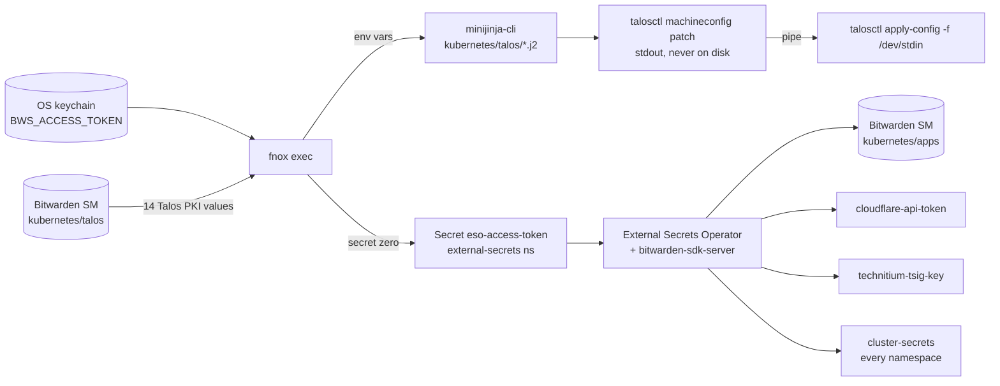
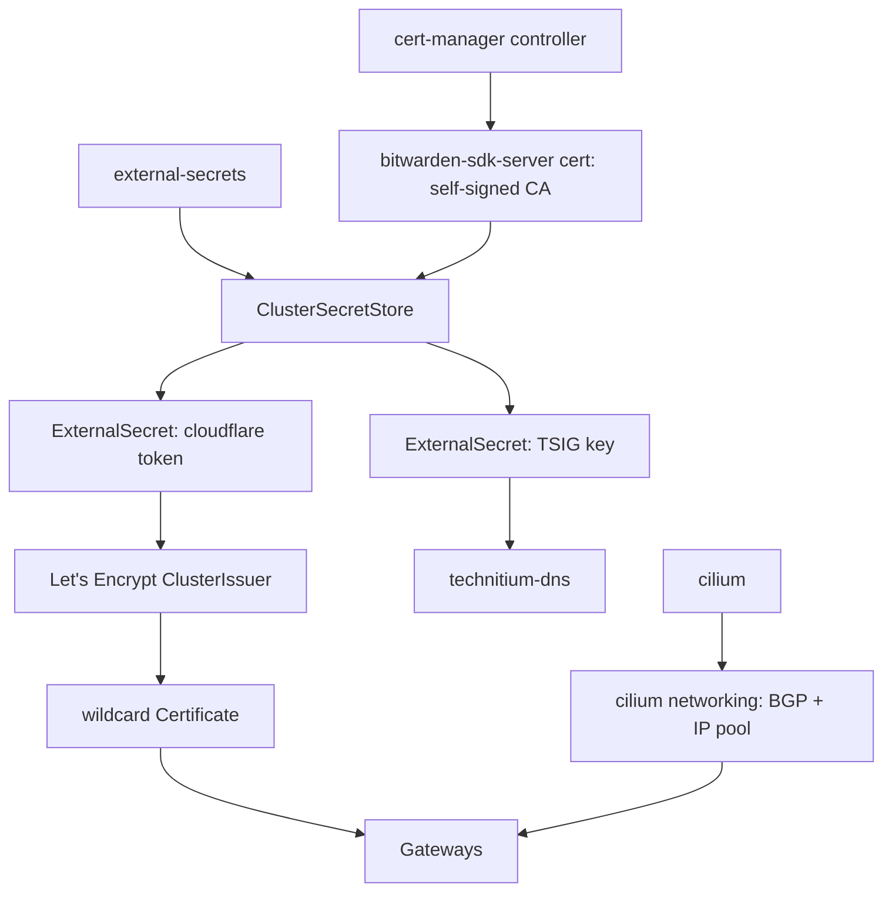

# Cluster design

A Talos cluster, configured for three control-plane nodes that also run workloads; the proof of concept runs one node (**revan**). Inspiration is [onedr0p/home-ops](https://github.com/onedr0p/home-ops), but built by hand to learn Kubernetes. Vocabulary: [GLOSSARY.md](../GLOSSARY.md). Decisions: [docs/adr/](adr/). Work: [GitHub milestones](https://github.com/d1ll3x/homeops-talos/milestones).

## Goal and success criteria

- The cluster can be rebuilt from **the repo + Bitwarden only**.
- Every component works: BGP LoadBalancer IPs are reachable, a route through the gateway serves a valid TLS certificate, and DNS records appear in Technitium automatically.
- I can explain why every piece exists.

**Working style: guided build.** Claude explains the concept and points to docs → **I write the config** → offline validation → Claude reviews → I apply → we verify → commit. Each issue carries **Learn / Write / Validate / Verify** sections instead of finished code.

## Decisions

| Topic             | Decision                                                                                                                                                                                                                                             | Why                                                                                                                                                                         |
| ----------------- | ---------------------------------------------------------------------------------------------------------------------------------------------------------------------------------------------------------------------------------------------------- | --------------------------------------------------------------------------------------------------------------------------------------------------------------------------- |
| Talos config tool | **minijinja-cli** rendering `kubernetes/talos/*.j2` in three layers (cluster → controlplane → node), driven by **just** recipes; mise = tools + env                                                                                                  | talhelper is archived; templates + `talosctl` keep one less abstraction between me and the Talos config ([ADR-0002](adr/0002-just-and-minijinja-for-talos.md))              |
| Order of work     | Talos → helmfile bootstrap → Flux manages everything                                                                                                                                                                                                 | Nothing gets redone later                                                                                                                                                   |
| Bootstrap scope   | helmfile installs cilium, coredns, spegel, cert-manager, external-secrets, bitwarden-secrets-manager and Flux; Flux adopts them                                                                                                                      | In-cluster secrets work from Flux's first reconcile ([ADR-0006](adr/0006-helmfile-bootstraps-cert-manager-and-eso.md))                                                      |
| Secrets           | **Bootstrap:** the Talos PKI in Bitwarden **Secrets Manager**, injected as env vars by `fnox exec`; templates read them as `{{ ENV.X }}`. `BWS_ACCESS_TOKEN` in the OS keychain. **In-cluster:** Bitwarden SM + External Secrets Operator. US region | No secret material in git, not even encrypted. One secret store for everything ([ADR-0001](adr/0001-home-ops-as-reference.md), [ADR-0007](adr/0007-bitwarden-us-region.md)) |
| Topology          | Every node is a **control plane that also runs workloads**; no worker nodes. Configs are written for **three** nodes; the proof of concept runs revan alone, and nodes 2–3 join in M9                                                                | Homelab: three small boxes give etcd quorum without separate workers                                                                                                        |
| API endpoint      | **`https://k8s.internal:6443`** → `<kube-api-ip>`, a Cilium `kube-api` LoadBalancer Service announced over BGP (`externalTrafficPolicy: Local`); each node also gets `<node>.internal`                                                               | Health-aware and ECMP across control planes; adding a node never changes the endpoint ([ADR-0005](adr/0005-dns-api-endpoint.md))                                            |
| Disks             | Per node in layer 3: Talos on the Samsung SATA SSD and the Crucial P3 NVMe (`CT1000P3SSD8`) as `RawVolumeConfig` `miroir` (grows to fill it), both by `disk.model`; `EPHEMERAL` capped at 100 GiB                                                    | Reinstalling Talos never touches data; a model match survives `/dev/sdX` renumbering                                                                                        |
| Storage           | **miroir** (LVM-thin, `dm_thin_pool`) with **DRBD loaded from M1**; volumes are `replicas: "1"` until M9, then move to a replicated class by snapshot + restore                                                                                      | CSI snapshots/clones on one node; Ceph unsuitable ([ADR-0003](adr/0003-miroir-local-only-storage.md))                                                                       |
| Rendered config   | Never on disk: `render-config` streams to stdout, `apply-node` pipes it into `talosctl`                                                                                                                                                              | PKI can't be committed or left behind ([ADR-0002](adr/0002-just-and-minijinja-for-talos.md))                                                                                |
| Versions          | `kubernetes/talos/version.yaml` (`talos_version`, `k8s_version`) feeds the templates through `mod.just`                                                                                                                                              | One place to bump; Renovate-ready                                                                                                                                           |
| Host extras       | Kept from home-ops: NFS client (`nfsrahead`, NFS `EtcFileConfig`s, sunrpc sysctls), IOMMU passthrough args                                                                                                                                           | NFS mounts and PCI passthrough are planned                                                                                                                                  |
| LB advertisement  | Cilium **BGP only**, separate subnet `<lb-pool>`                                                                                                                                                                                                     | IPs in the node's own VLAN would be unreachable from the server VLAN (ARP issue)                                                                                            |
| Internal DNS      | external-dns → **Technitium via RFC2136** (flat names, e.g. `grafana.<domain>`)                                                                                                                                                                      | No DNS in the cluster; one source of truth; keeps DNS control                                                                                                               |
| Cloudflare        | Only for cert-manager DNS-01 (wildcard `*.<domain>`)                                                                                                                                                                                                 | Public zone required for Let's Encrypt                                                                                                                                      |
| Network resolver  | Stays **outside** the cluster (move Technitium to the RPi5 later)                                                                                                                                                                                    | A single-node cluster must not take down the house's DNS                                                                                                                    |
| Flux source       | Public GitHub repo, anonymous HTTPS                                                                                                                                                                                                                  | Secret zero stays at one secret                                                                                                                                             |
| Private values    | Domain, LAN layout and ASNs live in BWS as `SECRET_<ROLE>`; Flux substitutes them from `cluster-secrets`, Talos reads them via fnox; docs use `<role>` placeholders                                                                                  | A public repo must not map my network or name me ([ADR-0008](adr/0008-private-values-from-secrets.md))                                                                      |

**Deliberate deviations from home-ops:**

- minijinja templates + fnox instead of 1Password (`op://` refs → `{{ ENV.X }}`)
- Bitwarden SM for all secrets: fnox on the workstation, ESO in-cluster. No SOPS anywhere
- `technitium-dns` (external-dns rfc2136, watching `envoy-internal`) instead of `cloudflare-dns` (watching `envoy-external`)
- No k8s-gateway and no cloudflared

## Conventions

- Keep layers 1–2 node-agnostic: whatever differs per node goes in layer 3.
- Node addresses come from **DHCP reservations**; Talos has no static fallback, so if UniFi DHCP is down at boot, the node has no address.
- Every app has the same shape: `apps/<ns>/<app>/ks.yaml` (Flux Kustomization: path, targetNamespace, dependsOn) and `app/{kustomization,ocirepository,helmrelease}.yaml`. helmfile reads chart url/tag from `ocirepository.yaml` and values from `helmrelease.yaml`, so bootstrap and Flux share one source of truth.
- Flux `Kustomization` objects live in their app's namespace. A `dependsOn` across namespaces needs both `name:` and `namespace:`.
- No Flux-side SOPS (`decryption` blocks, `sops-age` Secret). Private values are written as `${SECRET_<ROLE>}` and substituted from the `cluster-secrets` Secret ([ADR-0008](adr/0008-private-values-from-secrets.md)); never write the domain, IPs or ASNs literally.
- Flux pulls `https://github.com/d1ll3x/homeops-talos.git`, branch `main`, path `kubernetes/flux/cluster`, anonymously. Push before Flux can see a change.
- Never run `talosctl gen secrets`: it creates a new, incompatible Talos PKI.

## Review focus

The five failure modes most likely to bite, and the issue that tests each:

1. **Talos PKI leaks**: through a rendered config in the repo, a minijinja error that dumps every `ENV` value to the terminal, or a `talosctl gen secrets` that silently replaces the PKI. Render streams to talosctl and is never written; `git status` stays clean after rendering. Secret values in **terminal** output are an accepted risk (2026-10-18); they stay out of files and git.
2. **Wrong install disk**: the wrong disk is chosen and data is lost, or a selector matches nothing. The install disk and the miroir pool are selected by different `disk.model`s in the node file, with the USB stick **pulled before apply**. Same rule for the M7 rebuild and every new node.
3. **Split-horizon DNS breaks DNS-01**: Technitium answers `<domain>` itself, so cert-manager's propagation self-check never sees the `_acme-challenge` TXT. Recursive nameservers are forced to 1.1.1.1 DoH; the staging cert must reach Ready.
4. **UniFi firewall silently drops traffic**: BGP (TCP 179) from the server VLAN to the gateway, or the trusted VLAN → `<lb-pool>` (incl. TCP 6443 to `kube-api`). Test from both VLANs.
5. **external-dns modifies hand-made records** (e.g. `unifi.<domain>`). Start with `policy: upsert-only`, check `unifi` is unchanged, then switch to `sync`.

## Hardware and network

- **Node (revan):** Dell OptiPlex 3070, i5-8500T (6c), 32 GB DDR4
  - 500 GB Samsung 860 EVO SATA SSD (`sda`, Talos; WWID `<sda-wwid>`, no serial for SATA)
  - 1 TB Crucial P3 NVMe `CT1000P3SSD8` (miroir pool, serial `<nvme-serial>`)
  - onboard NIC `enp1s0` (`<enp1s0-mac>`); 2.5 GbE Realtek `enp2s0` (`<enp2s0-mac>`) reserved for future storage traffic
- **ISO:** Talos 1.14.1 on a Ventoy USB stick (shows up as `sdb`; pull it before apply). Installer image: `talos_version` in `kubernetes/talos/version.yaml`
- **BIOS:** UEFI, SATA **AHCI**, Secure Boot off

Network and hardware values are masked for privacy: each `<placeholder>` names a role, not a value. `<kube-api-ip>` is the BWS secret `SECRET_KUBE_API_IP`, written `${SECRET_KUBE_API_IP}` in manifests and `{{ ENV.SECRET_KUBE_API_IP }}` in Talos templates ([ADR-0008](adr/0008-private-values-from-secrets.md)).

| Item                                | Value                                                                                                                           |
| ----------------------------------- | ------------------------------------------------------------------------------------------------------------------------------- |
| Cluster / node                      | `kotor` / `revan`                                                                                                               |
| Server VLAN                         | `<server-subnet>`, gateway `<gateway-ip>`, untagged on the node port                                                            |
| IoT VLAN                            | tagged on the node port (`bond0.<iot-vlan-id>`, no node address); pods attach via Multus (mosquitto, zigbee2mqtt)               |
| MTU                                 | 9000 on every link (needs jumbo frames on the switch; an IoT VLAN device at 1500 drops large non-TCP packets)                   |
| Trusted clients                     | trusted VLAN                                                                                                                    |
| Kubernetes API                      | `k8s.internal` → `<kube-api-ip>` (`kube-api` LoadBalancer, from M3; the node IP until then)                                     |
| Nodes                               | revan `<revan-ip>` = `revan.internal`; `<malgus-ip>` = `malgus.internal`, `<bane-ip>` = `bane.internal` (A + PTR records exist) |
| Node DNS resolver                   | Technitium, handed out by UniFi DHCP (nodes must resolve `k8s.internal`)                                                        |
| LB pool (BGP only)                  | `<lb-pool>`                                                                                                                     |
| `envoy-internal` / `envoy-external` | `<envoy-internal-ip>` / `<envoy-external-ip>`                                                                                   |
| ASNs                                | UniFi `<router-asn>`, node `<cluster-asn>`                                                                                      |
| Pod / Service CIDR                  | `10.42.0.0/16` / `10.43.0.0/16`                                                                                                 |
| Domain                              | `<domain>`                                                                                                                      |

## Secrets flow



- **Workstation:** `fnox.toml` holds references only. `BWS_ACCESS_TOKEN` (machine account `mandalore`) comes from the OS keychain (fnox `keychain` provider, prefix `talos/`); the 14 Talos PKI values come from BWS project `kubernetes/talos` (provider `talos`), under home-ops' names (`MACHINE_CA_CRT`, …, `CLUSTER_SECRETBOXENCRYPTIONSECRET`).
- **Rendering:** `just talos render-config <node>` runs `fnox exec -- minijinja-cli` on the three layers, combines them with `talosctl machineconfig patch` and prints the result; `apply-node` pipes it into `talosctl apply-config -f /dev/stdin`. A failed layer inside `<( )` isn't caught by bash: read the `--dry-run` diff before every apply. `strict` (in `.minijinja.toml`) fails on any missing secret instead of rendering `null`.
- **The Talos PKI lives only in BWS.** `talosconfig` (gitignored) was generated from the same secrets and still works.
- **Secret zero:** the `ESO` machine account's token, read-only on `kubernetes/apps`, stored there for fnox's `apps` provider. The `base` stage of `just bootstrap cluster` renders `kubernetes/bootstrap/kustomize/external-secrets/secret.yaml` and applies it server-side before ESO is installed ([ADR-0004](adr/0004-secret-zero-cluster-machine-account.md)).
- **In-cluster:** BWS project `kubernetes/apps` holds `cloudflare-api-token` (Zone DNS:Edit on `<domain>`), `technitium-tsig-key` and the `SECRET_<ROLE>` private values; the `bitwarden-secrets-manager` ClusterSecretStore syncs them. The `cluster-secrets` ClusterExternalSecret puts the private values in every namespace for Flux substitution.
- **Leak guards:** `.gitignore` covers `secrets.yaml`, `talosconfig`, `kubeconfig`, keys and `.env`. For Claude Code there are Read deny rules plus a PreToolUse hook (`~/.claude/hooks/block-secret-leaks.sh`) that blocks commands that would print secret values.
- **Single point of failure:** the `mandalore` token. On a fresh workstation it has to be recovered from Bitwarden and put into the keychain before anything renders.

## Repo layout

```
.mise/config.toml             tools + env (KUBECONFIG, TALOSCONFIG, MINIJINJA_CONFIG_FILE, JUST_UNSTABLE)
.minijinja.toml               strict, trim/lstrip blocks, autoescape none
.justfile                     template helper (fnox exec → minijinja-cli), log helper, mod talos, mod bootstrap
fnox.toml                     references only: keychain token, BWS providers talos + apps
kubernetes/
  talos/
    mod.just                  render-config, apply-node, apply-cluster, upgrade-node, upgrade-k8s, reset-node, shutdown-node, download-image
    cluster.yaml.j2           layer 1: every node ({{ ENV.X }} secrets, network, DRBD modules, …)
    controlplane.yaml.j2      layer 2: CA keys, etcd, apiserver, scheduler
    nodes/controlplane/
      revan.yaml.j2           layer 3: hostname, zone label, install disk, EPHEMERAL, RawVolumeConfig miroir
    schematic.yaml            Image Factory schematic (not templated)
    version.yaml              talos_version, k8s_version
  bootstrap/
    mod.just                  `just bootstrap cluster`: stages talos → kubernetes → kubeconfig → base → apps
    kustomize/                secret zero (rendered through `just template`)
    helmfile/                 crds.yaml, apps.yaml (ADR-0006), default.yaml, templates/
  components/                 reusable kustomize components (namespace, alerts, gpu, zeroscaler)
  flux/cluster/ks.yaml        root Kustomization → kubernetes/apps
  apps/<ns>/<app>/            ks.yaml + app/{helmrelease,ocirepository,kustomization}.yaml
```

Git-ignored: `kubeconfig`, `talosconfig`. Rendered configs are never written anywhere.

## Bootstrap sequence

`just bootstrap cluster` runs these stages:

1. **talos**: `just talos apply-node <node> --insecure` for every node in `talosconfig` (skips nodes that already have config).
2. **kubernetes**: `talosctl bootstrap` until it reports `AlreadyExists`. etcd bootstrapped, API on the node IP. Node **NotReady** (no CNI yet, expected).
3. **kubeconfig**: `talosctl kubeconfig`, with the server pointed at the node IP until `k8s.internal` answers (M3).
4. **base**: waits for the apiserver, then applies secret zero and the CRDs from `helmfile/crds.yaml`.
5. **apps**: `helmfile sync` of `helmfile/apps.yaml`, in order: cilium (node becomes **Ready**; its BGP and LB pool come from `cilium/app/networking.yaml`) → coredns → spegel → cert-manager → external-secrets → bitwarden-secrets-manager (Certificate, then ClusterSecretStore) → flux-operator → flux-instance.

Flux then takes over everything, adopting the releases above.

## Apps (Flux)

| Namespace        | App                                               | Notes                                                                                                                                                                                           |
| ---------------- | ------------------------------------------------- | ----------------------------------------------------------------------------------------------------------------------------------------------------------------------------------------------- |
| kube-system      | cilium                                            | `app/networking.yaml`: `CiliumLoadBalancerIPPool`, BGP cluster/peer config (`<cluster-asn>` ↔ `<router-asn>` @ `<gateway-ip>`), LB IP advertisement, `kube-api` Service                         |
| kube-system      | coredns, spegel, metrics-server, reloader, multus |                                                                                                                                                                                                 |
| flux-system      | flux-operator, flux-instance                      | Flux manages itself                                                                                                                                                                             |
| cert-manager     | cert-manager                                      | Let's Encrypt ClusterIssuers (Cloudflare DNS-01); the Cloudflare ExternalSecret is not health-checked, so no cycle with Bitwarden ([ADR-0009](adr/0009-bitwarden-sdk-server-namespaced-pki.md)) |
| external-secrets | external-secrets, bitwarden-secrets-manager       | `bitwarden-sdk-server` + its namespaced self-signed → CA → leaf PKI, `ClusterSecretStore` `bitwarden-secrets-manager` → BWS `kubernetes/apps`                                                   |
| network          | envoy-gateway                                     | GatewayClass, `envoy-internal`, `envoy-external` (no routes yet), wildcard Certificate                                                                                                          |
| network          | technitium-dns                                    | external-dns `rfc2136`, watches `envoy-internal`, TXT ownership registry, zone `<domain>`                                                                                                       |
| miroir-system    | miroir                                            | `miroir-local` StorageClass, VolumeSnapshotClass                                                                                                                                                |

### Dependency chain



### Certificates: which is which

- **Self-signed:** only for ESO ↔ `bitwarden-sdk-server` inside the cluster. Namespaced `Issuer`s in `external-secrets`, so it needs only the cert-manager controller, not Bitwarden ([ADR-0009](adr/0009-bitwarden-sdk-server-namespaced-pki.md)).
- **Let's Encrypt wildcard:** served by the Gateways to browsers.
- **Technitium:** no certificate involved. RFC2136 updates travel over plain DNS (port 53), signed with the TSIG key.

### Outside the repo

- **UniFi:** FRR BGP config with local ASN `<router-asn>` and the `kotor` peer group (remote-as `<cluster-asn>`); DHCP reservations; firewall rules.
- **Technitium:** zone `k8s.internal` and `<node>.internal` records; dynamic updates on `<domain>`, restricted to the TSIG key.

If names don't resolve, check whether DNS-rebind protection is dropping answers that contain private IPs.

## Milestones

Each is a [GitHub milestone](https://github.com/d1ll3x/homeops-talos/milestones) holding its issues.

- **M0 Prep:** mise env, `.gitignore`, BWS project `kubernetes/talos` and the `mandalore` machine account, Talos PKI imported and wired through fnox. Done before the issue tracker existed.
- **M1 Talos:** templates, render → apply, `talosctl bootstrap`. _Done when_ the API answers on the node IP, the node is NotReady, DRBD is loaded and `r-miroir` is ready.
- **M2 Bootstrap:** secret zero + helmfile. _Done when_ the node is Ready, `cilium status` is OK, DNS works from a debug pod and `flux get ks -A` is all Ready.
- **M3 BGP:** cilium networking + UniFi FRR + Multus. _Done when_ `cilium bgp peers` shows Established, the `/32` routes appear on UniFi, a test LB Service is reachable from the server VLAN **and** the trusted VLAN, and `https://k8s.internal:6443` answers from the trusted VLAN.
- **M4 Basics:** metrics-server, reloader. _Done when_ `kubectl top node` works and a ConfigMap change restarts a test pod.
- **M5 Secrets & certs:** cert-manager, ESO, ClusterSecretStore, LE issuers. _Done when_ ExternalSecrets sync and a staging certificate issues, then production.
- **M6 Gateway & DNS:** envoy-gateway, Gateways, wildcard, technitium-dns. _Done when_ an `echo` HTTPRoute creates a record in Technitium and `https://echo.<domain>` has a valid certificate from the trusted VLAN.
- **M7 Rebuild drill:** `talosctl reset` → rebuild from repo + Bitwarden. _Done when_ the cluster comes back identical.
- **M8 Storage:** miroir local-only. _Done when_ a PVC binds and a snapshot restores into a new PVC.
- **M9 Three nodes:** join nodes 2 and 3, BGP peers for both, miroir replication. _Done when_ etcd has three members, three nodes are Ready, UniFi has an ECMP path per node for `<kube-api-ip>`, and a replicated PVC survives a node reboot.

## Out of scope (future projects)

- cloudflared / any external exposure
- Tailscale (subnet router advertising `<lb-pool>`)
- Moving Technitium to the RPi5
- kopiur backups
- Renovate
- Observability: the bootstrap CRDs include kube-prometheus-stack and grafana-operator, and apps ship PrometheusRules and GrafanaDashboards, but no milestone installs the stack yet

## References

- https://github.com/onedr0p/home-ops
- https://github.com/mitsuhiko/minijinja/tree/main/minijinja-cli
- https://fnox.jdx.dev/providers/bitwarden-sm
- https://external-secrets.io/latest/provider/bitwarden-secrets-manager/
- https://miroir.home-operations.com/
- https://docs.siderolabs.com/
